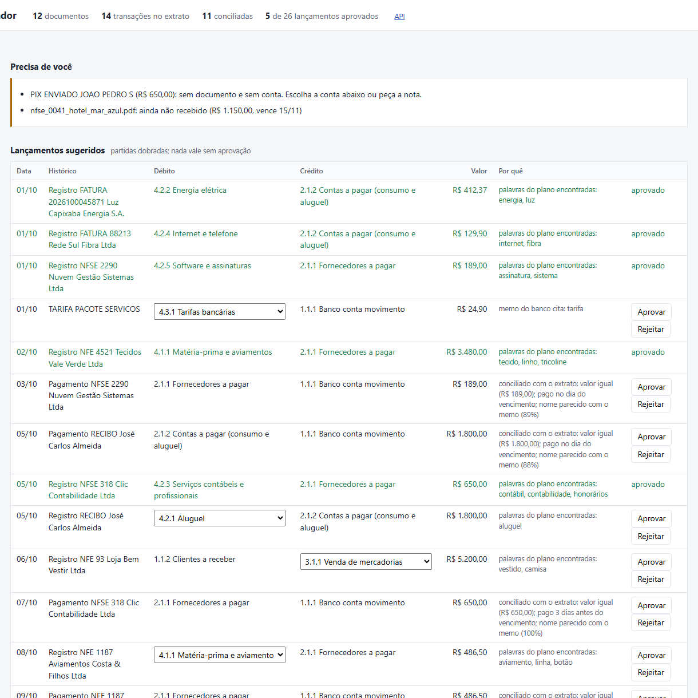

# Conciliador IA

Assistente de escrituração para pequena empresa. Lê as **notas fiscais, faturas e recibos** do mês (XML de NF-e,
PDF com texto, PDF escaneado, foto de recibo), lê o **extrato do banco** (OFX ou CSV), **concilia** cada
transação com o documento que ela paga ou recebe e **sugere os lançamentos contábeis** em partidas dobradas.
Nada vira lançamento aprovado sem uma pessoa conferir: a tela mostra por que cada coisa foi sugerida e o que
deixou o sistema em dúvida.

Python 3.12 · FastAPI · OpenCV + Tesseract · LLM com saída validada por schema · SciPy (algoritmo húngaro) ·
SQLAlchemy (SQLite ou PostgreSQL) · pytest · Docker · GitHub Actions



## O que ele faz, passo a passo

```
 XML NF-e ─┐                         OFX / CSV
 PDF ──────┼─> documentos/            extrato/
 foto ─────┘   ├ XML: leitura estruturada        └ transações (id estável: reimportar não duplica)
               ├ PDF: camada de texto ou OCR por página               │
               ├ OCR: OpenCV (deskew, fundo, Otsu, molduras) + Tesseract por
               ├ extração: regras (padrão) ou LLM com JSON Schema
               └ confiança calculada por regras auditáveis            │
                         │                                            │
                         └──────────────> conciliacao.py <────────────┘
                                          valor e sinal como filtro; score = data + nome (+ CNPJ no memo)
                                          atribuição global (húngaro), não gulosa
                                                   │
                                          lancamentos.py
                                          classificação: regras do plano de contas -> modelo só no que sobra
                                          registro (competência) + baixa (caixa) + avulsos (tarifa, rendimento)
                                                   │
                                          api.py + tela de revisão: aprovar, rejeitar, trocar conta, balancete
```

## Números medidos

Todos saem de `python scripts/avaliar.py` e dos relatórios em [`docs/`](docs). O cenário de exemplo é um ateliê de
costura em outubro de 2026: 12 documentos em 4 formatos, 14 transações no extrato e 5 armadilhas de propósito
(dois boletos iguais do mesmo fornecedor em datas diferentes, um PIX de mesmo valor para outra pessoa, recibos sem
CNPJ, uma fatura escaneada sem texto e uma venda ainda não recebida).

| Etapa | Resultado |
| --- | --- |
| Leitura, extrator de regras | **96 de 96 campos** (XML, PDF com texto, PDF escaneado e foto) |
| Leitura, extrator por LLM (gpt-4o-mini) | **93 de 96**; o erro que sobrou, um recibo em que o modelo trocou quem pagou por quem recebeu, sai com confiança 0,50 e vai para revisão |
| OCR sob estresse (rotação, ruído, baixa resolução, JPEG 10) | igual ao arquivo limpo; com desfoque forte erra, mas **nenhum erro passa sem alerta** |
| Conciliação | **11 de 11 pares**, precisão e revocação de 100%, as armadilhas caem nas sobras certas |
| Classificação no plano de contas | **14 de 14** (12 documentos + tarifa e rendimento) |
| Fluxo completo, do arquivo ao lançamento | 11 de 11 pares e 12 de 12 contas; todos os lançamentos fecham e o balancete bate |
| Testes | 304 (pytest), com OCR de verdade no CI |

Os documentos são sintéticos e o leitor por regras foi escrito conhecendo o layout deles. Os 100% mostram que o
caminho inteiro funciona, não a taxa que o sistema teria com documentos reais. Por isso o projeto também mede o
extrator por LLM e o OCR sob degradação, e trata confiança baixa como "manda para uma pessoa".

## Decisões que importam

- **Confiança se calcula, não se pergunta ao modelo.** Cada regra que falha vira um problema com mensagem legível e
  penalidade: CNPJ com dígito verificador inválido, valor que não aparece no texto, valor em algarismos diferente
  do valor por extenso, itens que não somam o total, OCR com confiança baixa, e, depois de rodar o gpt-4o-mini,
  "emitente do recibo é quem pagou". Abaixo de 0,8 o documento vai para as pendências.
- **O modelo não inventa.** Campo que não está no texto fica vazio; a resposta precisa passar no schema Pydantic e
  tem uma única nova tentativa com os erros de validação. Na classificação, o modelo só entra no que as regras não
  resolveram, e só vale se responder uma conta folha da lista permitida.
- **Conciliação global.** Valor e sinal (pagar sai, receber entra) filtram; data e nome do memo dão o score;
  o algoritmo húngaro escolhe o melhor conjunto de pares. A escolha gulosa erra quando dois documentos disputam a
  mesma transação, e há um teste com esse caso.
- **Partidas dobradas de verdade.** Registro na emissão (despesa contra fornecedores), baixa no extrato
  (fornecedores contra banco), espelho para vendas. Lançamento que não fecha, ou ainda "a classificar", não pode ser
  aprovado. Reprocessar troca só as sugestões: o que alguém aprovou ou rejeitou fica.

## Como foi construído

Com agentes de programação em paralelo, do jeito descrito no [AGENTS.md](AGENTS.md): primeiro o contrato de dados
(`modelos.py`), o cenário com gabarito e as regras do repositório; depois três frentes ao mesmo tempo, cada uma
numa git worktree e numa branch própria, entregues por pull request com CI e revisão:

- [#1](https://github.com/Kaylan00/conciliador-ia/pull/1) núcleo: plano de contas, lançamentos, API e tela
- [#2](https://github.com/Kaylan00/conciliador-ia/pull/2) extrato OFX/CSV e conciliação
- [#3](https://github.com/Kaylan00/conciliador-ia/pull/3) documentos: XML, PDF, OCR e extração

A integração pegou um bug real: a avaliação geral lia a chave errada do gabarito e mostrava 0 de 3 pares; com a
correção, o fluxo completo deu 11 de 11.

## Rodar

```bash
docker compose up --build          # API + PostgreSQL em http://localhost:8000 (tela) e /docs (Swagger)
```

Na tela, **Carregar exemplo** importa os 12 documentos e o extrato de `dados/exemplos/`. Para usar o modelo de
linguagem, defina `OPENROUTER_API_KEY` (e `EXTRATOR=llm` para a leitura).

Desenvolvimento e testes (Python 3.12 + Tesseract em português numa imagem):

```bash
docker build -f Dockerfile.dev -t conciliador-dev .
docker run --rm -v "$PWD":/app -w /app conciliador-dev pytest -q
docker run --rm -v "$PWD":/app -w /app conciliador-dev python scripts/avaliar.py
```

## Limites conhecidos

- Conciliação um para um: pagamento parcial, parcelas e um pagamento quitando várias notas ficam para revisão.
- Boleto pago com juros, multa ou desconto não casa pelo valor e vai para as sobras.
- NFS-e em XML e DANFE em PDF ainda não são lidos; NF-e com frete, desconto ou IPI daria um falso alerta de itens.
- O plano de contas é um modelo simplificado para estudo, não o plano de nenhum escritório.
- Sem autenticação nem multiempresa.
